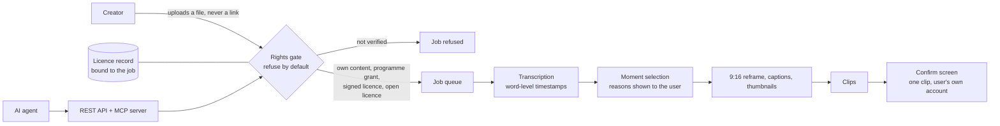

# MakeMyContent Clips (Clipwright): case study

**A video clipping service that checks rights before it processes anything.** Long video in, captioned vertical clips out, and every clip traceable to a licence.

Designed and built by [Iskra Astudillo](https://github.com/iskra-astudillo) at Elite AI Holdings, with AI coding agents doing most of the implementation under review. Source is private; this repo documents the design.

## Problem

Most clipping tools ask you to promise you have the rights, then leave the legal risk with you. Fair use is decided case by case, and platform reuse rules can demonetize a channel. A tool cannot make unlicensed footage legal, so a clipper that accepts anything is a liability for its own users.

## What it does

- **Refuses by default.** A job runs only when one of four routes is shown: the user's own long-form content, an opt-in programme that grants a licence, a signed licence, or an open-licence source.
- Transcribes with word-level timestamps.
- Selects moments and shows the reasons for each pick, not an opaque score.
- Exports 9:16 clips with burned-in captions taken from the real transcript, plus thumbnails.
- Publishes one clip at a time to the user's own account, after a confirmation screen.
- Offers a REST API and an MCP server so an AI agent can drive the same gated workflow.

## Architecture

## Engineering decisions

| Decision | Why |
|---|---|
| **The rights gate is the product.** It sits in front of the pipeline, and refusal is the default state. The licence record is stored with the job. | A licence check after processing is a formality. In front of the pipeline it is a control, and every clip can be traced back to its permission. |
| **No URL fetching.** Input is an uploaded file, on the site and through the API. | Pulling third-party video by link is the most common way clipping tools end up processing content nobody licensed. |
| **Explainable ranking with a safe fallback.** An optional model pass may re-order moments, but only using the reasons the transparent ranker produced. | The user can see why a moment was picked, and a model failure degrades to the transparent order instead of a guess. |
| **Captions come from the transcript.** | Captions that paraphrase can misquote the speaker. Burned-in text should be what was said. |
| **Publishing is deliberately slow.** One clip, one account, one confirmation. No bulk or scheduled auto-posting. | Platform terms and the creator's reputation both punish spray-and-pray posting. |
| **The API and MCP server go through the same gate.** | An agent should never have a side door that a human user does not. |

## Stack

Python services and a web app in Docker on self-hosted infrastructure, ffmpeg for video processing, speech-to-text with word timestamps, an MCP server for agent access. Built with Claude Code and Codex as the coding agents; I own the architecture, the review and the release decision.

## Status

- Live: https://clipwright.eliteaiempire.com (free signup)
- Source: private

## License

Documentation: CC BY 4.0. See [LICENSE](LICENSE).
